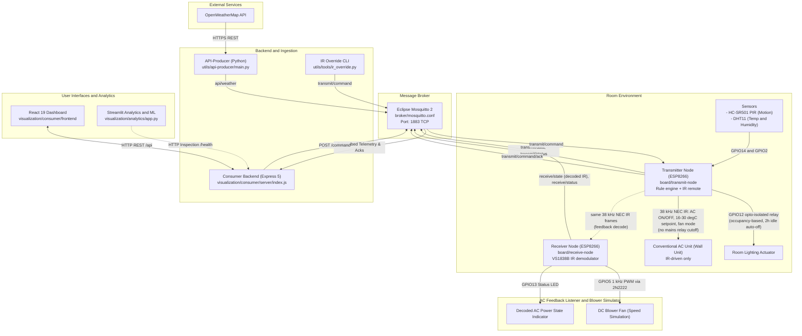

# IoT Auto Climate Control System — Documentation Hub

Welcome to the comprehensive technical documentation for the **IoT Auto Climate Control System**. This repository implements a multi-node, automated climate management and AC monitoring architecture combining embedded microcontrollers (ESP8266), an authenticated MQTT message broker (Mosquitto 2), an external weather poller, an Express 5 REST backend, a responsive React 19 dashboard, and a Python machine learning analytics suite.

---

## Documentation Navigation

This documentation is organized into modular guides covering every layer of the system:

| Document | Description | Key Topics |
| :--- | :--- | :--- |
| **[system-architecture.md](../docs/system-architecture.md)** | System Overview & Architecture | Node roles, physical topology, protocol stack, security boundaries, and communication flows. |
| **[mqtt-protocol-and-topics.md](../docs/mqtt-protocol-and-topics.md)** | MQTT Wire Protocol & Payloads | Complete topic catalog, Zod & JSON schemas, retain policies, LWT mechanics, and the 32-bit NEC IR protocol. |
| **[hardware-and-firmware.md](../docs/hardware-and-firmware.md)** | Hardware Specifications & Firmware | ESP8266 pinout mapping, HC-SR501 PIR, DHT11, KY-005 IR emitter, VS1838B receiver, the transmitter lighting relay, PWM fan circuit, rule engine, and override logic. |
| **[consumer-backend-api.md](../docs/consumer-backend-api.md)** | Consumer Backend & REST API | Express 5 architecture, in-memory ring buffer (`TelemetryStore`), `MqttService`, command dispatch lifecycle, and all REST endpoints. |
| **[frontend-dashboard.md](../docs/frontend-dashboard.md)** | Frontend Web Application | React 19 + TypeScript + Vite, theme engine, polling hooks, manual control forms, optimistic drafts, and asset management. |
| **[analytics-and-ml.md](../docs/analytics-and-ml.md)** | Machine Learning & Analytics Hub | 100k synthetic dataset generation, physics-based energy model, regression pipelines, benchmarks, and the 6-tab Streamlit dashboard. |
| **[broker-and-infrastructure.md](../docs/broker-and-infrastructure.md)** | Broker Deployment & Security | Eclipse Mosquitto 2 containerization, credentials administration (`manage_mqtt_auth.sh`), TCP/WebSocket listeners, and network troubleshooting. |
| **[deployment-guide.md](../docs/deployment-guide.md)** | Production Deployment Guide | Turnkey multi-container Docker Compose, Process Manager (PM2/Systemd), Nginx SSL reverse proxy, and hardware provisioning. |
| **[utilities-and-testing.md](../docs/utilities-and-testing.md)** | Utilities, Tools & Testing Suite | OpenWeatherMap poller (`api-producer`), IR override CLI (`ir_override.py`), end-to-end integration test (`e2e_integration_test.py`), unit tests, and Playwright UI tests. |

---

## High-Level System Architecture



---

## Technology Stack Matrix

| Component | Language / Framework | Runtime / Platform | Primary Responsibilities | Reference Location |
| :--- | :--- | :--- | :--- | :--- |
| **Transmitter Node** | C++ (Arduino Core) | ESP8266 (NodeMCU v2 / D1) | Samples PIR & DHT11, runs rule engine, fires IR signals for AC control, controls light relay, processes manual commands. | [transmit-node.ino](../board/transmit-node/transmit-node.ino) |
| **Receiver Node** | C++ (Arduino Core) | ESP8266 (NodeMCU v2 / D1) | Decodes 38 kHz NEC IR signals, modulates fan PWM (2N2222) for speed simulation, publishes verified AC operating state. | [receive-node.ino](../board/receive-node/receive-node.ino) |
| **MQTT Broker** | C (Eclipse Mosquitto 2) | Docker Alpine | Central message bus, user authentication, topic persistence, WebSocket bridging. | [mosquitto.conf](../broker/mosquitto.conf) |
| **API Producer** | Python 3.10+ (`requests`, `paho-mqtt`) | Linux Daemon / CLI | Polls OpenWeatherMap REST API, synthesizes weather fallback, publishes retained weather data. | [main.py](../utils/api-producer/main.py) |
| **Consumer Backend** | JavaScript (Node.js >= 22.12, Express 5, Zod) | Node.js / Docker | Ingests MQTT streams, in-memory sliding window ring buffer, command dispatch & ACK correlation, REST API. | [index.js](../visualization/consumer/server/index.js) |
| **Consumer Frontend** | TypeScript, React 19, Vite 6 | Browser / SPA | Real-time climate monitoring, localized Indonesian dashboard, manual overrides, dark/light theme. | [App.tsx](../visualization/consumer/frontend/src/App.tsx) |
| **Analytics & ML** | Python 3 (`scikit-learn`, `pandas`, `plotly`, `streamlit`) | Python Virtualenv | Synthetic telemetry generator (100k rows), power consumption regression, interactive diagnostic dashboard. | [app.py](../visualization/analytics/app.py) |
| **IR Override CLI** | Python 3 (`paho-mqtt`) | CLI Utility | Operator tool for raw NEC IR frames, immediate state overrides, and duration control. | [ir_override.py](../utils/tools/ir_override.py) |

---

## Quickstart & Orchestration Guide

To run the entire ecosystem locally on a developer workstation:

### 1. Start the Mosquitto MQTT Broker
```bash
cd broker
docker compose up -d
```
Verify that container `iot-mosquitto-broker` is running and bound to ports `1883` and `9001`.

### 2. Launch the Consumer Backend & Frontend
```bash
cd visualization/consumer
npm ci
cp .env.example .env

# Option A: Start both Express API (port 8000) and Vite Web UI (port 5173) concurrently:
npm run dev

# Option B: Run via Docker Compose:
docker compose up --build -d
```
The REST API is accessible at `http://localhost:8000/health`, and the web dashboard is live at `http://localhost:8000` (or `http://localhost:5173` in development mode).

### 3. Run the OpenWeatherMap Producer
```bash
cd utils/api-producer
python3 -m venv venv
source venv/bin/activate
pip install -r requirements.txt
cp .env.example .env

# Publish once for verification or run daemon:
python main.py --once
```

### 4. Run the End-to-End System Integration Test
```bash
python3 scripts/e2e_integration_test.py
```
This automated suite spins up simulated nodes, verifies MQTT message propagation, and validates REST endpoint contracts.

### 5. Launch the Analytics & ML Dashboard
```bash
cd visualization/analytics
python3 -m venv venv
source venv/bin/activate
pip install -r requirements.txt

# 1. Generate 100,000 synthetic telemetry rows (if not already generated)
python generate_mock_data.py --rows 100000

# 2. Train and evaluate regression models
python train_regression_model.py --compare-all

# 3. Start Streamlit dashboard
streamlit run app.py
```
The analytics dashboard is accessible at `http://localhost:8501`.

---

## Workspace Directory Map

```text
.
├── board/                         # Embedded firmware sketches and flashing scripts
│   ├── compile.sh                 # Arduino CLI compilation command
│   ├── upload.sh                  # Arduino CLI USB flashing command
│   ├── receive-node/              # ESP8266 AC Emulator / Receiver Node
│   │   ├── receive-node.ino       # VS1838B IR decoder, 1 kHz fan PWM, state LEDs (no AC relay)
│   │   ├── secrets.h              # Private Wi-Fi & MQTT credentials
│   │   └── secrets.h.example      # Credential template
│   └── transmit-node/             # ESP8266 Sensor & Remote Controller Node
│       ├── transmit-node.ino      # PIR, DHT11, KY-005 IR sender, light relay
│       ├── secrets.h              # Private Wi-Fi & MQTT credentials
│       └── secrets.h.example      # Credential template
├── broker/                        # Eclipse Mosquitto MQTT broker container definition
│   ├── docker-compose.yaml        # Container definition with port mappings & volumes
│   ├── mosquitto.conf             # Listener, security, and persistence configuration
│   ├── passwd                     # Hashed user credentials file
│   └── README.md                  # Broker administrative notes
├── docs/                          # Comprehensive multi-page technical documentation
│   ├── README.md                  # Documentation index & system navigation
│   ├── system-architecture.md     # Node roles, protocols, and security model
│   ├── mqtt-protocol-and-topics.md# MQTT schemas, topics, and 32-bit IR specs
│   ├── hardware-and-firmware.md   # Schematics, pinouts, rules, and timers
│   ├── consumer-backend-api.md    # Express 5 REST API and MQTT store logic
│   ├── frontend-dashboard.md      # React 19 UI, hooks, and manual controls
│   ├── analytics-and-ml.md        # ML regression, mock dataset, and Streamlit
│   ├── broker-and-infrastructure.md# Mosquitto setup, auth scripts, and network
│   └── utilities-and-testing.md   # Weather producer, CLI tools, tests
├── scripts/                       # DevOps, diagnostic, and automation utilities
│   ├── debug_broker.py            # Diagnostic script testing socket and MQTT auth
│   ├── e2e_integration_test.py    # End-to-end integration and latency benchmark
│   └── manage_mqtt_auth.sh        # Broker user credential management script
├── utils/                         # Peripheral services and operator tools
│   ├── api-producer/              # OpenWeatherMap poller & publisher
│   │   ├── main.py                # Periodic weather fetcher
│   │   └── requirements.txt       # Dependencies (requests, paho-mqtt)
│   └── tools/                     # Operational command line tools
│       ├── ir_override.py         # Manual AC override & raw IR MQTT CLI
│       └── requirements.txt       # CLI dependencies
└── visualization/                 # User interfaces and analytics platforms
    ├── analytics/                 # Machine learning & data science hub
    │   ├── app.py                 # 6-tab Streamlit interactive dashboard
    │   ├── generate_mock_data.py  # High-fidelity 100k telemetry synthesizer
    │   ├── train_regression_model.py # ML training, benchmarking & serialization
    │   ├── requirements.txt       # Data science dependencies
    │   ├── data/                  # Output directory for telemetry CSV datasets
    │   └── models/                # Serialized model (.joblib) & metrics (.json)
    └── consumer/                  # Web dashboard & REST API service
        ├── Dockerfile             # Multi-stage production container build
        ├── compose.yaml           # Consumer Docker Compose specification
        ├── package.json           # Root workspace configuration
        ├── frontend/              # React 19 + TypeScript + Vite web client
        │   ├── src/               # UI components, hooks, and types
        │   └── vite.config.ts     # Vite configuration & proxy settings
        ├── server/                # Express 5 backend & MQTT service
        │   ├── app.js             # Express routes, CSP, and error handlers
        │   ├── config.js          # Zod environment schema validation
        │   ├── mqtt-service.js    # MQTT client, message routing, command ACK
        │   ├── schemas.js         # Payload normalization & validation schemas
        │   ├── store.js           # Sliding ring buffer telemetry repository
        │   └── topics.js          # Canonical topic constants & alias resolver
        └── tests/                 # Playwright UI & Docker smoke test suites
```
