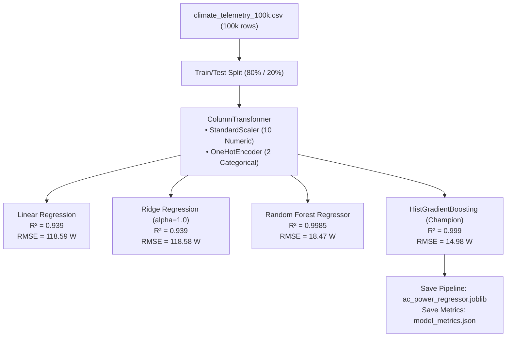

# Analytics, Machine Learning & Streamlit Hub

The analytics interface is integrated into the main React dashboard as the **Analitik** tab at `/#analitik`. See the [current analytics setup and API guide](../visualization/analytics/README.md) for local and Docker instructions. The scikit-learn model, training scripts, dataset, and optional Streamlit research interface remain in `visualization/analytics/`.

The SPA offers energy summaries, hourly power and temperature patterns, occupancy comparisons, model benchmarks, scenario predictions, and CSV inference. A small Python JSON adapter loads the existing artifacts; Express proxies `/api/analytics/*` on the dashboard's origin. Compose starts both services and keeps the Python service off public host ports. Data is explicitly labelled synthetic, and actual dataset counts are computed rather than inferred from its filename.

The sections below document the underlying generator, training workflow, and optional Streamlit interface.

---

## 1. Subsystem Architecture & Directory Map

```text
visualization/analytics/
├── requirements.txt            # Python dependencies (scikit-learn, streamlit, plotly, pandas)
├── generate_mock_data.py       # High-fidelity 100,000-row synthetic telemetry generator
├── train_regression_model.py   # Multi-model trainer, evaluator, and artifact generator
├── app.py                      # 6-tab interactive Streamlit analytics dashboard
├── README.md                   # Quick reference guide
├── data/                       # Dataset storage directory
│   └── climate_telemetry_100k.csv  # 100,000-row telemetry dataset
└── models/                     # Model artifacts and evaluation metrics
    ├── ac_power_regressor.joblib    # Serialized scikit-learn champion pipeline
    ├── model_metrics.json          # Performance scorecard and benchmark metrics
    └── test_predictions_sample.csv # 2,000-sample test set with actual vs predicted values
```

---

## 2. Physics-Based Synthetic Telemetry Generator

Source: [generate_mock_data.py](../visualization/analytics/generate_mock_data.py)

To rigorously train and benchmark machine learning models without waiting months for physical sensor collection, the system synthesizes 100,000 sequential 1-minute telemetry rows that strictly obey the laws of thermodynamics, weather dynamics, human occupancy cycles, and inverter AC compressor characteristics.

### 2.1 Mathematical & Thermodynamic Formulas

#### 1. Diurnal Outdoor Temperature Dynamics
The outdoor temperature follows a diurnal sinusoidal solar curve peaking at 14:00 and reaching minimum temperature at 05:00, modulated by multi-day synoptic weather fronts (a 5.2-day cyclic fluctuation):

$$\text{Phase}_{solar} = \frac{2\pi \cdot (\text{hour} - 5)}{24}$$

$$T_{outdoor} = 28.0 + 5.5 \cdot \sin\left(\text{Phase}_{solar} - \frac{\pi}{2}\right) + 2.0 \cdot \sin\left(\frac{2\pi \cdot \text{day}}{5.2}\right) + \mathcal{N}(0, 0.8)$$

Values are clipped to the realistic tropical boundary: $21.0^\circ\text{C} \le T_{outdoor} \le 39.0^\circ\text{C}$.

#### 2. Atmospheric Relative Humidity
Outdoor humidity is inversely correlated with ambient temperature:

$$\text{Hum}_{outdoor} = 92.0 - 1.8 \cdot (T_{outdoor} - 20.0) + \mathcal{N}(0, 3.5)$$

Clipped to $45.0\% \le \text{Hum}_{outdoor} \le 98.0\%$.

#### 3. Human Room Occupancy Modeling
Occupancy probability depends on time-of-day and whether the day is a weekday or weekend:
- **Weekday Work Hours (08:00 - 18:00):** $P(\text{occupancy}) = 0.82$, maximum 10 occupants.
- **Weekday Evening (18:00 - 22:30):** $P(\text{occupancy}) = 0.40$, maximum 10 occupants.
- **Weekend Day:** $P(\text{occupancy}) = 0.25$, maximum 4 occupants.
- **Nighttime:** $P(\text{occupancy}) \le 0.10$.
Occupancy count is smoothed using a 10-minute rolling window so people do not artificially appear and disappear in single-minute spikes.

#### 4. Indoor Thermal Evolution Differential Equation
At each discrete time step $t$, the room temperature $T_{room}$ updates according to cooling removal rate and ambient heat ingress:

$$\Delta T_{cooling} = 0.08 \cdot (T_{room} - T_{target}) \quad \text{if AC is active}$$

$$\Delta T_{warming} = 0.03 \cdot (T_{environment} - T_{room})$$

$$T_{room}(t) = T_{room}(t-1) - \Delta T_{cooling} + \Delta T_{warming} + \mathcal{N}(0, 0.05)$$

#### 5. Inverter AC Electrical Power Equation (Regression Target)
A physical model of a 1.5 PK Inverter AC unit estimates electrical power consumption ($P_{ac}$ in Watts):

$$\text{When AC is OFF (Standby):} \quad P_{ac} = 4.5\text{ W} + \mathcal{N}(0, 0.4)$$

$$\text{When AC is ACTIVE:} \quad P_{ac} = \Big[ 290.0 + (92.0 \cdot \Delta T) + (24.5 \cdot \text{Lift}_{out}) + (48.0 \cdot N_{occ}) + (4.2 \cdot \text{Latent}_{hum}) \Big] \cdot \text{FanMult} + \epsilon$$

Where:
- $290.0\text{ W}$ is base compressor baseline work.
- $\Delta T = \max(0, T_{room} - T_{target})$ is cooling thermal demand.
- $\text{Lift}_{out} = \max(0, T_{outdoor} - 25.0)$ is outdoor heat rejection lift.
- $N_{occ}$ is human metabolic thermal load (approx. 48 W electrical equivalent per person).
- $\text{Latent}_{hum} = \max(0, \text{Hum}_{indoor} - 50.0)$ is latent moisture condensation work.
- $\text{FanMult}$: Multiplier based on fan speed (`Off: 0.0`, `Low: 0.88`, `Medium: 1.0`, `Auto: 1.05`, `High: 1.18`).
- $\epsilon \sim \mathcal{N}(0, 16.0\text{ W})$ represents electrical grid noise and line harmonics. Active power is bounded between $180\text{ W}$ and $2250\text{ W}$.

---

### 2.2 Feature Dictionary (17 Telemetry Columns)

| Column Name | Data Type | Units / Range | Physical Meaning |
| :--- | :--- | :--- | :--- |
| `timestamp` | `datetime64` | ISO-8601 | 1-minute sequential timestamp. |
| `hour_of_day` | `float64` | 0.00 – 23.98 | Fractional hour of the day. |
| `day_of_week` | `int64` | 0 – 6 | Day index (0 = Monday, 6 = Sunday). |
| `is_weekend` | `int64` | 0 or 1 | Weekend indicator flag. |
| `indoor_temp_c` | `float64` | 16.5°C – 34.5°C | Indoor ambient temperature (DHT11 reading). |
| `indoor_humidity`| `float64` | 38.0% – 85.0% | Indoor relative humidity (DHT11 reading). |
| `outdoor_temp_c` | `float64` | 21.0°C – 39.0°C | Outdoor temperature (OpenWeatherMap feed). |
| `outdoor_humidity`| `float64` | 45.0% – 98.0% | Outdoor humidity (OpenWeatherMap feed). |
| `weather_condition`| `string` | Categorical | Condition: Clear, Clouds, Rain, Thunderstorm. |
| `motion_detected` | `int64` | 0 or 1 | PIR sensor motion state (HC-SR501). |
| `occupancy_count` | `int64` | 0 – 10 | Estimated count of human occupants. |
| `target_temp_c` | `int64` | 16°C – 30°C | Target AC setpoint sent via IR. |
| `temp_delta` | `float64` | °C | Thermal gap: `indoor_temp_c - target_temp_c`. |
| `fan_speed` | `string` | Categorical | Fan mode: Off, Low, Medium, High, Auto. |
| `relay_state` | `int64` | 0 or 1 | Telemetry validation flag (mirrors logical `ac_power_state`). |
| `ac_power_state` | `int64` | 0 or 1 | Operating state commanded via IR: 1 = Active cooling, 0 = Standby. |
| **`ac_power_consumption_w`** | `float64` | **Watts** | **Regression Target: Electrical power draw.** |

---

## 3. Machine Learning Training & Evaluation Pipeline

Source: [train_regression_model.py](../visualization/analytics/train_regression_model.py)

### 3.1 Preprocessing Pipeline
Features are separated and transformed inside a scikit-learn `ColumnTransformer`:
- **Numeric Pipeline (`StandardScaler`):** Applied to 10 features (`indoor_temp_c`, `indoor_humidity`, `outdoor_temp_c`, `outdoor_humidity`, `occupancy_count`, `target_temp_c`, `temp_delta`, `hour_of_day`, `motion_detected`, `ac_power_state`).
- **Categorical Pipeline (`OneHotEncoder`):** Applied to 2 categorical features (`weather_condition`, `fan_speed`) with `handle_unknown="ignore"`.

### 3.2 Model Comparison Benchmarks
The pipeline trains and evaluates four candidate regression algorithms on an 80/20 train/test split:



#### Official Model Benchmark Scorecard
Source: [model_metrics.json](../visualization/analytics/models/model_metrics.json)

| Model Name | $R^2$ Score | RMSE (Watts) | MAE (Watts) | MAPE (%) | Explained Variance | Fit Duration |
| :--- | :--- | :--- | :--- | :--- | :--- | :--- |
| **HistGradientBoosting (Champion)** | **0.9990** | **14.98 W** | **9.63 W** | **5.67%** | **0.9990** | **0.627 s** |
| **Random Forest Regressor** | 0.9985 | 18.47 W | 11.37 W | 4.12% | 0.9985 | 1.076 s |
| **Ridge Regression** | 0.9390 | 118.58 W | 95.16 W | 927.18% | 0.9390 | 0.026 s |
| **Linear Regression** | 0.9390 | 118.59 W | 95.17 W | 927.19% | 0.9390 | 0.050 s |

*Champion Selection:* `HistGradientBoostingRegressor` is chosen as the champion model because it delivers superior non-linear modeling of compressor cutoff thresholds, fits in under 1 second, and achieves a sub-15 Watt root mean squared error.

---

## 4. Streamlit Interactive Analytics Dashboard

Source: [app.py](../visualization/analytics/app.py)

The dashboard presents 6 full-featured analytical modules:

```text
Streamlit Dashboard Tabs:
├── 1. 📊 Executive Overview       # KPI cards, energy cost calculator, physical topology
├── 2. 📈 Analytics (EDA)          # Diurnal heat curves, correlation heatmaps, occupancy impact
├── 3. 🧠 Model Evaluation         # Parity scatter, residual histograms, feature rankings
├── 4. 🔮 Real-Time Sandbox        # Interactive sliders, live inference, efficiency rating
├── 5. ⚡ Batch & Scenarios        # Heatwave / Eco presets & custom CSV batch inference
└── 6. 🔗 IoT Hardware API         # Live inspection of Consumer REST API & MQTT health
```

### Tab 1: 📊 Executive Overview
- Displays high-level summary KPI metric cards: **Total Telemetry Hours**, **Mean AC Power Load (Watts)**, **Standby Power Load**, and **Champion Model $R^2$**.
- **Energy Cost Calculator:** Automatically computes cumulative energy consumed in kilowatt-hours (kWh) and estimates operating cost in **Indonesian Rupiah (IDR)** (Tarif Listrik PLN: Rp 1.444,70 / kWh) and **US Dollars (USD)** ($0.095 / kWh).
- Displays the complete hardware communication topology diagram.

### Tab 2: 📈 Analytics (EDA)
- **Diurnal Profiles:** Plotly interactive line charts illustrating outdoor heat vs indoor cooling response across 24 hours.
- **Correlation Heatmap:** Matrix visualizing correlation between indoor humidity, occupancy count, temperature gap (`temp_delta`), and power consumption.
- **Occupancy Distribution:** Box plots displaying the metabolic load effect on compressor modulation.

### Tab 3: 🧠 Model Evaluation
- **Parity Scatter Plot:** Plots Actual vs Predicted AC Power (Watts) with a 45° reference line.
- **Residual Distribution Histogram:** Normal distribution plot of prediction errors ($y_{actual} - y_{pred}$) centered at 0 Watts.
- **Feature Importance Chart:** Bar ranking of features influencing power demand.

### Tab 4: 🔮 Real-Time Prediction Sandbox
- Provides real-time interactive input widgets:
  - **Indoor Temperature Slider:** 16°C to 35°C
  - **Indoor Relative Humidity Slider:** 30% to 90%
  - **Outdoor Temperature Slider:** 20°C to 42°C
  - **Occupant Count Stepper:** 0 to 10 persons
  - **Target Temperature Setpoint:** 16°C to 30°C
  - **Fan Speed Selector:** Low, Medium, High, Auto, Off
  - **AC Power Toggle:** Standby vs Active
- **Instant Inference:** Passes parameters through the champion model and calculates predicted load in Watts, hourly energy cost, and an **Efficiency Grade** (A+ to F).

### Tab 5: ⚡ Batch & Scenarios
- **Preconfigured Scenarios:**
  - *Tropical Heatwave:* Extreme outdoor heat (38°C) with full occupancy.
  - *Eco Night Mode:* Mild ambient conditions with target set to 26°C.
  - *Empty Room Auto-Off:* Rule verification when occupants vacate.
- **CSV Batch Ingestion:** Drag-and-drop file uploader accepting arbitrary telemetry CSV files for high-throughput batch prediction and downloadable CSV reports.

### Tab 6: 🔗 IoT Hardware API
- Directly probes the Consumer REST API (`http://localhost:8000/api/health` and `/api/dashboard`).
- Displays live hardware connectivity flags, MQTT client status, and recent physical sensor samples.

---

## 5. Usage & CLI Execution Guide

### 1. Generate Dataset
```bash
cd visualization/analytics
python generate_mock_data.py --rows 100000 --output data/climate_telemetry_100k.csv
```

### 2. Train Models
```bash
python train_regression_model.py --compare-all
```

### 3. Launch Streamlit Application
```bash
streamlit run app.py
```
Access the dashboard at `http://localhost:8501`.
