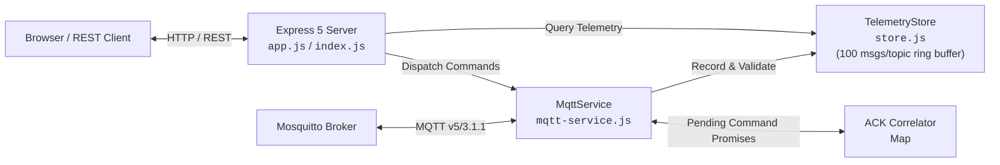
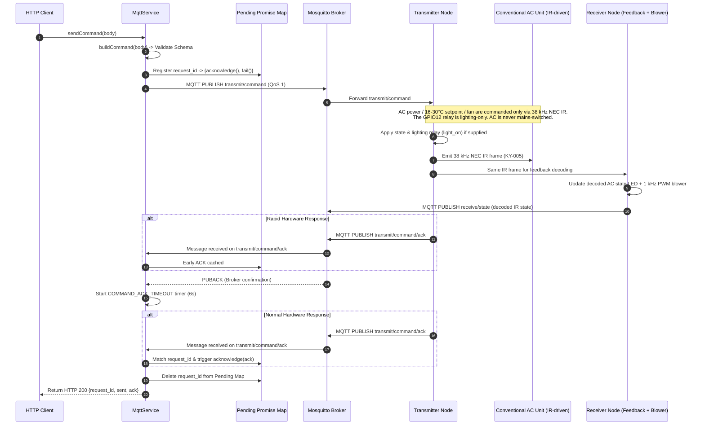

# Consumer Backend & REST API Specification

This document provides complete technical specifications for the **Consumer Node** backend service located in [visualization/consumer/server/](../visualization/consumer/server/). The service is built with **Node.js (>= 22.12)** and **Express 5**, providing real-time MQTT telemetry ingestion, in-memory sliding ring buffering, synchronous command-to-ACK correlation, and a comprehensive REST API.

---

## 1. Backend Architecture & Components

The Consumer service decouples ingestion, storage, network command dispatch, and HTTP presentation into clean modules:



### Module Responsibilities
- **[config.js](../visualization/consumer/server/config.js):** Validates and coerces all environment variables using Zod schemas at startup. Crashes early if parameters are out of range.
- **[topics.js](../visualization/consumer/server/topics.js):** Declares canonical topic strings, subscription lists, and an alias resolver mapping human queries (`"transmit"`, `"receive"`, `"weather"`, `"command"`, `"receive/ack"`) to their exact MQTT topic paths.
- **[schemas.js](../visualization/consumer/server/schemas.js):** Defines runtime Zod validation schemas for incoming MQTT payloads, normalizes JSON data, and validates command request bodies.
- **[store.js](../visualization/consumer/server/store.js):** Maintains in-memory FIFO ring buffers (max 100 entries per topic) and stores per-topic arrival metadata (`received_at`, `schema_valid`, `retained`).
- **[mqtt-service.js](../visualization/consumer/server/mqtt-service.js):** Manages the Paho/MQTT.js client lifecycle, handles automatic reconnects, and coordinates the synchronous command dispatch and ACK correlation pipeline.
- **[app.js](../visualization/consumer/server/app.js):** Instantiates the Express 5 router, Helmet security policies, CORS handling, compression, and error middleware.

---

## 2. Environment Configuration

Configuration variables are parsed from process environment variables or an optional `.env` file in `visualization/consumer/.env`:

| Environment Variable | Zod Type & Constraints | Default Value | Description |
| :--- | :--- | :--- | :--- |
| `HOST` | `string.min(1)` | `0.0.0.0` | HTTP network interface bind address. |
| `PORT` | `integer(1, 65535)` | `8000` | HTTP server listening port. |
| `MQTT_HOST` | `string.min(1)` | `127.0.0.1` | Mosquitto broker host or IP address. |
| `MQTT_PORT` | `integer(1, 65535)` | `1883` | Mosquitto broker TCP port. |
| `MQTT_PROTOCOL` | `enum('mqtt', 'mqtts')` | `mqtt` | Transport protocol (`mqtt` for TCP, `mqtts` for TLS). |
| `MQTT_USER` | `string` | `iot_user` | MQTT username for authentication. |
| `MQTT_PASS` | `string` | `iot_password` | MQTT password for authentication. |
| `MQTT_CLIENT_ID` | `string.optional()` | Generated | Custom client identifier. Defaults to `consumer-express-<uuid>`. |
| `COMMAND_ACK_TIMEOUT` | `number(0.1, 120)` | `6` | Max seconds to await hardware ACK after broker confirms publish. |
| `COMMAND_PUBLISH_TIMEOUT`| `number(0.1, 30)` | `2` | Max seconds to await broker PUBACK packet. |
| `STALE_AFTER_SECONDS` | `integer(5, 3600)` | `30` | Threshold in seconds after which telemetry is marked stale. |
| `CORS_ORIGIN` | `string` | `""` (Empty) | Comma-separated allowed CORS browser origins. Empty = same-origin. |

---

## 3. REST API Endpoint Specifications

All REST endpoints are dual-mounted: they are available at the root URL (e.g. `GET /health`) and under the `/api` prefix (e.g. `GET /api/health`). All responses return `Content-Type: application/json` and enforce `Cache-Control: no-store`.

### 3.1 `GET /health` & `GET /api/health`
Checks service health and MQTT broker connection status.

- **Method:** `GET`
- **Path:** `/health` or `/api/health`
- **Status Code:** `200 OK`
- **Response Schema:**
  ```json
  {
    "status": "ok",
    "mqtt": true,
    "subscriptions_ready": true
  }
  ```
- **Field Descriptions:**
  - `status`: Constant `"ok"` indicating HTTP process liveness.
  - `mqtt`: `true` if the MQTT client is currently connected to Mosquitto.
  - `subscriptions_ready`: `true` if all telemetry subscriptions have been confirmed by the broker.

#### Curl Example
```bash
curl -X GET http://localhost:8000/api/health
```

---

### 3.2 `GET /dashboard` & `GET /api/dashboard`
Returns a unified consolidated snapshot of all topics, node states, freshness metadata, and server time.

- **Method:** `GET`
- **Path:** `/dashboard` or `/api/dashboard`
- **Status Code:** `200 OK`
- **Response Schema:**
  ```json
  {
    "health": {
      "status": "ok",
      "mqtt": true,
      "subscriptions_ready": true
    },
    "transmit": {
      "motion": true,
      "temp": 28.5,
      "hum": 64.0,
      "timestamp": 1763428800,
      "fan_speed": "high",
      "relay_on": true,
      "light_on": true,
      "target_temp": 21,
      "sensor_ok": true,
      "ir_sent": true,
      "uptime_ms": 36120,
      "override": false,
      "ir_code": "0xA18715EA"
    },
    "receive": {
      "ac_power_state": true,
      "temp": 21.0,
      "fan_speed": "high",
      "fan_pwm": 1023,
      "timestamp": 1763428801,
      "state_valid": true,
      "source": "ir-change"
    },
    "transmit_status": {
      "online": true
    },
    "receive_status": {
      "online": true
    },
    "command": {
      "ok": true,
      "request_id": "dash-1763428900-5162a",
      "action": "override",
      "override": true,
      "applied": {
        "relay_on": true,
        "light_on": true,
        "target_temp": 22,
        "fan_speed": "medium"
      }
    },
    "weather": {
      "city": "Jakarta",
      "temp_c": 31.4,
      "hum": 78,
      "desc": "scattered clouds",
      "ts": 1763428800
    },
    "metadata": {
      "transmit": {
        "received_at": "2026-11-18T05:40:00.123Z",
        "schema_valid": true,
        "retained": false
      },
      "receive": {
        "received_at": "2026-11-18T05:40:00.250Z",
        "schema_valid": true,
        "retained": false
      },
      "transmit_status": {
        "received_at": "2026-11-18T05:35:10.000Z",
        "schema_valid": true,
        "retained": true
      },
      "receive_status": {
        "received_at": "2026-11-18T05:35:12.000Z",
        "schema_valid": true,
        "retained": true
      },
      "command": {
        "received_at": "2026-11-18T05:38:22.000Z",
        "schema_valid": true,
        "retained": false
      },
      "weather": {
        "received_at": "2026-11-18T05:30:00.000Z",
        "schema_valid": true,
        "retained": true
      }
    },
    "stale_after_seconds": 30,
    "server_time": "2026-11-18T05:40:05.678Z"
  }
  ```

#### Curl Example
```bash
curl -X GET http://localhost:8000/api/dashboard
```

---

### 3.3 `GET /:topic/latest` & `GET /api/:topic/latest`
Fetches the most recent validated payload for a specific topic or alias.

- **Method:** `GET`
- **Path:** `/:topic/latest` or `/api/:topic/latest`
- **Supported Topic Aliases:**
  - `transmit` or `transmit/data` -> Latest transmitter telemetry
  - `receive`, `receive/state`, or `receive/ack` -> Latest receiver state
  - `transmit_status` or `transmit/status` -> Latest transmitter online presence
  - `receive_status` or `receive/status` -> Latest receiver online presence
  - `command`, `command/ack`, or `transmit/command/ack` -> Latest command ACK
  - `weather` or `api/weather` -> Latest external weather update
- **Status Codes:**
  - `200 OK`: Returns the JSON payload.
  - `404 Not Found`: If topic is unknown or if no payload has been received yet.

#### Example Request & Response
```bash
curl -X GET http://localhost:8000/api/transmit/latest
```
```json
{
  "motion": true,
  "temp": 28.5,
  "hum": 64.0,
  "timestamp": 1763428800,
  "fan_speed": "high",
  "relay_on": true,
  "light_on": true,
  "target_temp": 21,
  "sensor_ok": true,
  "ir_sent": true,
  "uptime_ms": 36120,
  "override": false
}
```

---

### 3.4 `GET /history/*topic` & `GET /api/history/*topic`
Retrieves chronological telemetry history from the in-memory ring buffer (up to 100 items).

- **Method:** `GET`
- **Path:** `/history/:topic` or `/api/history/:topic`
- **Status Codes:**
  - `200 OK`: Array of historical messages (empty `[]` if no messages yet received).
  - `404 Not Found`: If the requested topic is not tracked.

#### Example Request
```bash
curl -X GET http://localhost:8000/api/history/transmit/data
```
```json
[
  { "motion": false, "temp": 27.8, "hum": 65.0, "timestamp": 1763428790, ... },
  { "motion": false, "temp": 27.9, "hum": 65.1, "timestamp": 1763428795, ... },
  { "motion": true,  "temp": 28.5, "hum": 64.0, "timestamp": 1763428800, ... }
]
```

---

### 3.5 `POST /command` & `POST /api/command`
Submits a manual control command, publishes it with QoS 1 to `transmit/command`, and blocks until the matching ACK arrives from the Transmitter or a timeout occurs.

- **Method:** `POST`
- **Path:** `/command` or `/api/command`
- **Headers:** `Content-Type: application/json`

#### Action 1: Override Climate Parameters
```json
{
  "action": "override",
  "relay_on": true,
  "target_temp": 23,
  "fan_speed": "medium",
  "duration_s": 120,
  "request_id": "custom-req-001"
}
```

#### Action 2: Release Override
```json
{
  "action": "release",
  "request_id": "custom-req-002"
}
```

#### Action 3: Send Raw NEC Infrared Frame
```json
{
  "action": "raw",
  "ir_code": "0xA18710EF",
  "duration_s": 60,
  "request_id": "custom-req-003"
}
```

#### Response Structure (`200 OK`)
When the transmitter confirms execution within `COMMAND_ACK_TIMEOUT`:
```json
{
  "request_id": "custom-req-001",
  "sent": {
    "action": "override",
    "duration_s": 120,
    "request_id": "custom-req-001",
    "relay_on": true,
    "target_temp": 23,
    "fan_speed": "medium"
  },
  "ack": {
    "ok": true,
    "request_id": "custom-req-001",
    "action": "override",
    "override": true,
    "override_indefinite": false,
    "raw_only": false,
    "override_source": "mqtt",
    "override_remaining_s": 120,
    "applied": {
      "relay_on": true,
      "light_on": true,
      "target_temp": 23,
      "fan_speed": "medium"
    },
    "ir_code": "0xA18617E8",
    "timestamp": 1763428950
  }
}
```

#### Response Structure When Transmitter is Offline (`200 OK` with Warning)
If the MQTT publish succeeds but the transmitter does not reply within `COMMAND_ACK_TIMEOUT` (default: 6s):
```json
{
  "request_id": "custom-req-001",
  "sent": { ... },
  "ack": null,
  "detail": "No ACK received within 6 s; the transmitter may be offline."
}
```

#### Error Status Codes
| HTTP Status | Reason | Cause |
| :--- | :--- | :--- |
| `409 Conflict` | Command already pending | A command with the same `request_id` is currently awaiting an ACK. |
| `422 Unprocessable Content` | Validation failure | Missing action, invalid temperature range, illegal fan speed, or malformed IR code. |
| `429 Too Many Requests` | Concurrency limit reached | More than 100 commands are concurrently pending in memory. |
| `502 Bad Gateway` | Publish timeout | Mosquitto broker did not confirm packet delivery within `COMMAND_PUBLISH_TIMEOUT` (2s). |
| `503 Service Unavailable` | Broker disconnected | Backend is currently disconnected from Mosquitto; command was not dispatched. |

#### Error Format
All errors return a standard JSON object containing a `detail` string:
```json
{
  "detail": "target_temp must be between 16 and 30 Celsius"
}
```

---

## 4. In-Memory Store & Freshness Engine

Source: [store.js](../visualization/consumer/server/store.js)

### Sliding Ring Buffer Mechanics
1. **FIFO Ingestion:** When a message arrives on an active topic, `store.record(topic, payload)` normalizes the data against the topic's Zod schema.
2. **Capacity Enforcement:** The store maintains a maximum of 100 records (`limit = 100`). When a 101st message arrives, the oldest element is removed (`buffer.splice(0, buffer.length - this.limit)`).
3. **Freshness Tracking:** Each topic records an ISO-8601 receipt timestamp (`received_at`). In the frontend, if `Date.now() - Date.parse(metadata.received_at) > STALE_AFTER_SECONDS * 1000`, the data is marked stale.

---

## 5. Synchronous Command-ACK Pipeline

Source: [mqtt-service.js](../visualization/consumer/server/mqtt-service.js)


