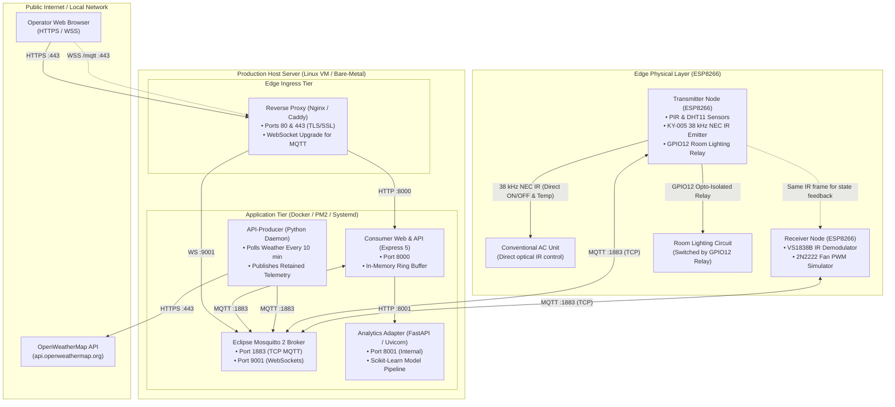

# Production Deployment Guide: IoT Auto Climate Control System

This guide provides end-to-end instructions for deploying all services in the **IoT Auto Climate Control** platform to a production environment. It covers containerized multi-service deployment with **Docker Compose**, host-native service orchestration with **Process Managers (Systemd / PM2)**, **Nginx / Caddy** reverse proxy setup with automated SSL/TLS certificates, security hardening, and field provisioning for ESP8266 microcontrollers.

---

## 1. Production Architecture Overview

In production, the platform consists of five interconnected subsystems:



> [!IMPORTANT]
> **Core Safety & Architectural Principle:**
> Air conditioner power (ON/OFF) is commanded **strictly and exclusively via 38 kHz NEC infrared (IR) signals**. The AC unit is **never** cut off from mains line voltage via an electrical relay switch, protecting compressor components and oil lubrication cycles. The relay actuator on the Transmitter Node (`GPIO12`) is strictly and exclusively dedicated to controlling the **room lighting** based on occupancy.

---

## 2. Server Prerequisites & System Sizing

### 2.1 Hardware Requirements
| Resource | Minimum (Lab / Single Room) | Recommended (Production / Multi-Room) |
| :--- | :--- | :--- |
| **CPU** | 1 vCPU (x86_64 or ARM64) | 2 vCPUs |
| **RAM** | 1 GB RAM | 2 GB to 4 GB RAM |
| **Storage** | 10 GB SSD / eMMC | 20 GB SSD |
| **OS** | Ubuntu 22.04/24.04 LTS, Debian 12, or Raspberry Pi OS (64-bit) | Ubuntu 24.04 LTS |

### 2.2 Host Software Packages
Install Docker Engine, Docker Compose, and network diagnostics on Ubuntu/Debian:
```bash
sudo apt update && sudo apt install -y \
    curl \
    git \
    ufw \
    mosquitto-clients \
    ca-certificates

# Install Docker Engine & Compose plugin (if not already installed)
curl -fsSL https://get.docker.com | sudo sh
sudo usermod -aG docker $USER
newgrp docker
```

---

## 3. Production Deployment Strategy A: Unified Docker Compose (Recommended)

The repository provides a production-grade multi-container orchestrator: [docker-compose.prod.yaml](../docker-compose.prod.yaml). It defines isolated networks, read-only root filesystems, non-root users, resource boundaries, and automated health checks.

### 3.1 Production Environment Configuration
Create a production environment file `.env` in the repository root:

```bash
cp visualization/consumer/.env.example .env
```

Edit `.env` with your production parameters:
```ini
# Production Network & Ports
PORT=8000

# MQTT Broker Authentication
MQTT_USER=iot_user
MQTT_PASS=StrongProductionPassword123!
MQTT_CLIENT_ID=prod-consumer-01

# Command & Staleness Timeouts
COMMAND_ACK_TIMEOUT=6
COMMAND_PUBLISH_TIMEOUT=2
STALE_AFTER_SECONDS=30
CORS_ORIGIN=https://climate.yourdomain.com

# OpenWeatherMap API Settings
OPENWEATHER_API_KEY=your_actual_openweathermap_api_key_here
CITY=Jakarta
POLL_SECONDS=600
```

### 3.2 Initialize Broker Authentication
Initialize the Mosquitto credentials file with your production password using the project's helper script:

```bash
# Set execute permissions
chmod +x scripts/manage_mqtt_auth.sh

# Reset credentials with the production password specified in .env
./scripts/manage_mqtt_auth.sh reset iot_user "StrongProductionPassword123!"
```

Verify that the password file has correct ownership and permissions:
```bash
ls -la broker/passwd
# Should display mode 0700 (-rwx------)
```

### 3.3 Harden Broker Configuration
For production deployments, enforce authentication by disabling anonymous access in [broker/mosquitto.conf](../broker/mosquitto.conf):

```ini
# Security & Authentication
allow_anonymous false
password_file /mosquitto/config/passwd
```

### 3.4 Build and Launch the Stack
Start all services in detached mode with automated health checking:

```bash
docker compose -f docker-compose.prod.yaml up -d --build
```

### 3.5 Verify Container Health & Status
```bash
docker compose -f docker-compose.prod.yaml ps
```

Expected healthy output:
```text
NAME                    IMAGE                         COMMAND                  SERVICE      STATUS                    PORTS
iot-mosquitto-broker    eclipse-mosquitto:2           "/docker-entrypoint.…"   broker       Up (healthy)              0.0.0.0:1883->1883/tcp, 0.0.0.0:9001->9001/tcp
iot-analytics-adapter   auto-climate-analytics:latest "python -m uvicorn a…"   analytics    Up (healthy)              8001/tcp
iot-consumer-web        auto-climate-consumer:latest  "docker-entrypoint.s…"   consumer     Up (healthy)              0.0.0.0:8000->8000/tcp
iot-weather-producer    auto-climate-producer:latest  "python main.py"         producer     Up                        
```

Test the consumer health endpoint:
```bash
curl -s http://localhost:8000/api/health | jq .
```
Expected response:
```json
{
  "status": "ok",
  "mqtt": true,
  "subscriptions_ready": true
}
```

---

## 4. Production Deployment Strategy B: Process Manager (PM2 & Systemd)

For lightweight bare-metal environments or resource-constrained single-board computers (e.g. Raspberry Pi), services can be run natively using **PM2** or **Systemd**.

### 4.1 Prerequisites for Native Deployment
```bash
# Install Node.js 22 LTS
curl -fsSL https://deb.nodesource.com/setup_22.x | sudo -E bash -
sudo apt install -y nodejs python3 python3-venv python3-pip mosquitto

# Install PM2 globally
sudo npm install -g pm2
```

### 4.2 Step 1: Mosquitto Broker Setup (Systemd)
Configure the native Mosquitto daemon:
```bash
sudo cp broker/mosquitto.conf /etc/mosquitto/conf.d/iot-climate.conf
sudo cp broker/passwd /etc/mosquitto/passwd
sudo chown mosquitto:mosquitto /etc/mosquitto/passwd
sudo chmod 700 /etc/mosquitto/passwd

sudo systemctl restart mosquitto
sudo systemctl enable mosquitto
```

### 4.3 Step 2: Build Consumer Web Assets
```bash
cd visualization/consumer
npm ci
npm run build
```

### 4.4 Step 3: Setup Python Virtual Environments
```bash
# 1. Setup Analytics API Virtualenv
cd ../analytics
python3 -m venv .venv
source .venv/bin/activate
pip install -r requirements-api.txt
deactivate

# 2. Setup API-Producer Virtualenv
cd ../../utils/api-producer
python3 -m venv .venv
source .venv/bin/activate
pip install -r requirements.txt
deactivate
cd ../..
```

### 4.5 Step 4: PM2 Multi-Process Orchestration
Create `ecosystem.config.cjs` in the repository root:

```javascript
module.exports = {
  apps: [
    {
      name: 'iot-consumer',
      cwd: './visualization/consumer',
      script: 'server/index.js',
      env: {
        NODE_ENV: 'production',
        HOST: '127.0.0.1',
        PORT: 8000,
        MQTT_HOST: '127.0.0.1',
        MQTT_PORT: 1883,
        MQTT_USER: 'iot_user',
        MQTT_PASS: 'StrongProductionPassword123!',
        ANALYTICS_URL: 'http://127.0.0.1:8001',
      },
      instances: 1,
      autorestart: true,
      max_memory_restart: '256M',
    },
    {
      name: 'iot-analytics',
      cwd: './visualization/analytics',
      script: '.venv/bin/uvicorn',
      args: 'api:app --host 127.0.0.1 --port 8001 --limit-concurrency 32',
      interpreter: 'none',
      autorestart: true,
      max_memory_restart: '512M',
    },
    {
      name: 'iot-weather-producer',
      cwd: './utils/api-producer',
      script: '.venv/bin/python',
      args: 'main.py',
      interpreter: 'none',
      env: {
        MQTT_HOST: '127.0.0.1',
        MQTT_PORT: 1883,
        MQTT_USER: 'iot_user',
        MQTT_PASS: 'StrongProductionPassword123!',
        CITY: 'Jakarta',
        POLL_SECONDS: '600',
      },
      autorestart: true,
      max_memory_restart: '128M',
    },
  ],
};
```

Launch and configure boot persistence:
```bash
pm2 start ecosystem.config.cjs
pm2 save
pm2 startup
# Follow the printed sudo instruction to install the systemd startup hook
```

---

## 5. Reverse Proxy & SSL/TLS Termination (Nginx)

Exposing internal microservices directly to the Internet is insecure. In production, run an **Nginx** reverse proxy that handles TLS termination, rate-limiting, and WebSocket upgrades.

### 5.1 Nginx Site Configuration
Create `/etc/nginx/sites-available/iot-climate.conf`:

```nginx
# Upstream Definitions
upstream consumer_backend {
    server 127.0.0.1:8000;
    keepalive 32;
}

upstream mqtt_websocket {
    server 127.0.0.1:9001;
}

# Redirect HTTP to HTTPS
server {
    listen 80;
    listen [::]:80;
    server_name climate.yourdomain.com;
    return 301 https://$host$request_uri;
}

# HTTPS Server Block
server {
    listen 443 ssl http2;
    listen [::]:443 ssl http2;
    server_name climate.yourdomain.com;

    # SSL Certificates (managed by Certbot)
    ssl_certificate /etc/letsencrypt/live/climate.yourdomain.com/fullchain.pem;
    ssl_certificate_key /etc/letsencrypt/live/climate.yourdomain.com/privkey.pem;
    ssl_protocols TLSv1.2 TLSv1.3;
    ssl_ciphers HIGH:!aNULL:!MD5;
    ssl_prefer_server_ciphers on;
    ssl_session_cache shared:SSL:10m;
    ssl_session_timeout 1d;

    # Security Headers
    add_header X-Frame-Options "DENY" always;
    add_header X-Content-Type-Options "nosniff" always;
    add_header Referrer-Policy "strict-origin-when-cross-origin" always;
    add_header Strict-Transport-Security "max-age=31536000; includeSubDomains" always;

    # Gzip Compression
    gzip on;
    gzip_types text/plain text/css application/json application/javascript text/xml application/xml;

    # Client Request Body Limit (for batch CSV predictions)
    client_max_body_size 6M;

    # Static Assets Caching
    location /assets/ {
        proxy_pass http://consumer_backend;
        proxy_set_header Host $host;
        expires 1y;
        add_header Cache-Control "public, immutable";
    }

    # REST API & Web Dashboard
    location / {
        proxy_pass http://consumer_backend;
        proxy_http_version 1.1;
        proxy_set_header Host $host;
        proxy_set_header X-Real-IP $remote_addr;
        proxy_set_header X-Forwarded-For $proxy_add_x_forwarded_for;
        proxy_set_header X-Forwarded-Proto $scheme;
        proxy_read_timeout 60s;
        proxy_connect_timeout 5s;
    }

    # Mosquitto MQTT WebSockets Bridge
    location /mqtt {
        proxy_pass http://mqtt_websocket;
        proxy_http_version 1.1;
        proxy_set_header Upgrade $http_upgrade;
        proxy_set_header Connection "Upgrade";
        proxy_set_header Host $host;
        proxy_read_timeout 86400s;
        proxy_send_timeout 86400s;
    }
}
```

Enable site and acquire Let's Encrypt certificate:
```bash
sudo ln -s /etc/nginx/sites-available/iot-climate.conf /etc/nginx/sites-enabled/
sudo nginx -t
sudo systemctl reload nginx

# Generate SSL certificates
sudo apt install -y certbot python3-certbot-nginx
sudo certbot --nginx -d climate.yourdomain.com
```

---

## 6. Edge Hardware Field Provisioning (ESP8266)

### 6.1 Configure Hardware Secrets (`secrets.h`)
Configure each microcontroller sketch with production network credentials:

#### Transmitter Node: `board/transmit-node/secrets.h`
```c
#ifndef SECRETS_H
#define SECRETS_H

// Production Wi-Fi Credentials
#define WIFI_SSID     "Office_Production_IoT"
#define WIFI_PASSWORD "WPA3_Enterprise_Pass"

// Production Mosquitto Broker Host (Server LAN IP or Domain)
#define MQTT_HOST     "192.168.1.100"
#define MQTT_PORT     1883
#define MQTT_USER     "iot_user"
#define MQTT_PASS     "StrongProductionPassword123!"

#endif
```

#### Receiver Node: `board/receive-node/secrets.h`
Use the same broker host, port, and authentication credentials.

### 6.2 Flashing Nodes via Arduino CLI
Compile and upload sketches directly from your development workstation:

```bash
# 1. Compile sketches
arduino-cli compile --fqbn esp8266:esp8266:nodemcuv2 board/transmit-node
arduino-cli compile --fqbn esp8266:esp8266:nodemcuv2 board/receive-node

# 2. Flash Transmitter Node over USB
arduino-cli upload -p /dev/ttyUSB0 --fqbn esp8266:esp8266:nodemcuv2 board/transmit-node

# 3. Flash Receiver Node over USB
arduino-cli upload -p /dev/ttyUSB1 --fqbn esp8266:esp8266:nodemcuv2 board/receive-node
```

### 6.3 Field Installation & Placement Guidelines
1. **Transmitter Node (IR Emitter & Sensors):**
   - **IR Emitter (KY-005):** Must have a direct, unobstructed **line-of-sight** to the AC unit's infrared receiver window within a 5-meter radius.
   - **PIR Sensor (HC-SR501):** Mount at a height of 2.0 to 2.4 meters, facing the room entrance or high-occupancy seating zone. Keep away from heat radiators or direct sunlight.
   - **DHT11 Sensor:** Place away from air conditioning vents and electronic components to avoid skewed temperature readings.
   - **Lighting Relay (`GPIO12`):** Wire in series with the room lighting phase circuit inside an approved electrical junction box.
2. **Receiver Node (Feedback Listener & Blower Simulator):**
   - Position near the AC unit with the VS1838B sensor oriented towards the room to reliably capture transmitter pulses.
   - Connect the DC blower fan via the 2N2222 transistor circuit for physical airflow simulation.

---

## 7. Production Security & Firewall Hardening

### 7.1 Host Firewall Setup (`ufw`)
Only open the ports strictly required for operation:

```bash
# Default policies: block all inbound, allow outbound
sudo ufw default deny incoming
sudo ufw default allow outgoing

# Allow SSH management
sudo ufw allow 22/tcp

# Allow Web Traffic (HTTP / HTTPS)
sudo ufw allow 80/tcp
sudo ufw allow 443/tcp

# Allow MQTT Traffic from local IoT Wi-Fi subnet ONLY (e.g. 192.168.1.0/24)
sudo ufw allow from 192.168.1.0/24 to any port 1883 proto tcp

# Enable firewall
sudo ufw enable
```

### 7.2 File Permissions & Secrets Protection
```bash
# Restrict permissions on sensitive configuration files
chmod 600 .env
chmod 600 broker/passwd
chmod 600 board/transmit-node/secrets.h
chmod 600 board/receive-node/secrets.h
```

---

## 8. Backup, Disaster Recovery & Rolling Updates

### 8.1 Automated Backup Script
Create `/usr/local/bin/backup-iot-climate.sh`:

```bash
#!/usr/bin/env bash
set -euo pipefail

BACKUP_DIR="/var/backups/iot-climate"
TIMESTAMP=$(date +"%Y%m%d_%H%M%S")
PROJECT_ROOT="$(cd "$(dirname "$0")/.." && pwd)"

mkdir -p "$BACKUP_DIR"

echo "[*] Creating backup at $BACKUP_DIR/backup_$TIMESTAMP.tar.gz..."
tar -czf "$BACKUP_DIR/backup_$TIMESTAMP.tar.gz" \
    -C "$PROJECT_ROOT" \
    broker/passwd \
    broker/data \
    broker/mosquitto.conf \
    visualization/analytics/models \
    .env

# Retain backups for 14 days
find "$BACKUP_DIR" -type f -name "backup_*.tar.gz" -mtime +14 -delete
echo "[+] Backup completed successfully."
```

Make executable and schedule daily via cron:
```bash
sudo chmod +x /usr/local/bin/backup-iot-climate.sh
(crontab -l 2>/dev/null; echo "0 3 * * * /usr/local/bin/backup-iot-climate.sh >/dev/null 2>&1") | crontab -
```

### 8.2 Rolling Zero-Downtime Updates
When pulling fresh application updates from git:

```bash
# 1. Pull latest code
git pull origin main

# 2. Rebuild and restart containers gracefully
docker compose -f docker-compose.prod.yaml up -d --build --no-deps consumer analytics producer

# 3. Verify health
docker compose -f docker-compose.prod.yaml ps
curl -f http://localhost:8000/api/health
```

---

## 9. Production Troubleshooting Runbook

| Symptom | Probable Cause | Diagnostic Command | Remediation Action |
| :--- | :--- | :--- | :--- |
| **`503 Service Unavailable` on `/api/dashboard`** | Mosquitto broker is stopped or rejecting credentials. | `docker logs iot-mosquitto-broker` | Check broker password with `manage_mqtt_auth.sh`. Verify container health with `docker inspect --format='{{.State.Health.Status}}' iot-mosquitto-broker`. |
| **AC does not respond to automated rules** | IR LED emitter misaligned or obstructed. | Check serial monitor on TX (`115200` baud) | Verify line-of-sight between KY-005 and AC unit. Check that `ir_sent: true` is reported in `transmit/data`. |
| **Room lights remain on after occupants leave** | 2-hour idle timeout (`LIGHT_IDLE_MS`) has not elapsed. | Inspect `uptime_ms` and PIR poll logs | Wait for the 2-hour idle window or inspect PIR sensitivity trimpot on the HC-SR501. |
| **Dashboard displays `Layanan terputus`** | Consumer process crashed or port 8000 blocked. | `docker logs iot-consumer-web` | Inspect Node.js error trace. Verify container memory limit is sufficient (> 256MB). |
| **Stale telemetry warning on UI (`Menunggu data`)** | ESP8266 Wi-Fi dropped or broker IP unreachable. | Run `python3 scripts/debug_broker.py` | Verify Wi-Fi signal at microcontroller location. Verify broker host firewall allows port 1883 from node IP. |
| **Broker logs `Permission denied` on `passwd`** | File permissions not set to `1883:1883` / `0700`. | `ls -la broker/passwd` | Run `./scripts/manage_mqtt_auth.sh list` to automatically enforce Mosquitto 2 ownership and permissions. |
