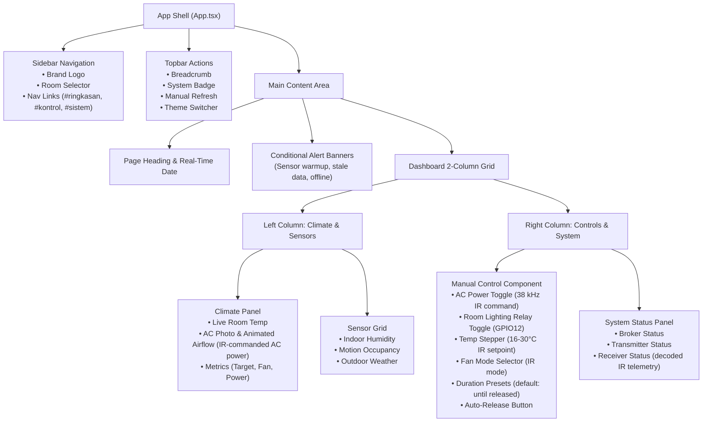

# Frontend Web Application & User Interface

This document specifies the architecture, state management, components, themes, and design patterns of the **AutoClimate Dashboard** web application located in [visualization/consumer/frontend/](file:///home/frdn/Downloads/Kuliah/IoT/Proyek/visualization/consumer/frontend/).

---

## 1. Technical Stack & Key Decisions

- **Framework:** React 19 (`react`, `react-dom`) with TypeScript.
- **Build Tool:** Vite 6 with `@vitejs/plugin-react`.
- **Icons:** Lucide React (`lucide-react`).
- **Typography:** Self-hosted **Source Sans 3** font files (`400`, `500`, `600`, `700` weights) in modern WOFF2 format located in `public/fonts/`. No external Google Fonts CDN requests are made, enabling seamless offline LAN operation.
- **Styling Architecture:** Pure modular CSS ([App.css](file:///home/frdn/Downloads/Kuliah/IoT/Proyek/visualization/consumer/frontend/src/App.css), [index.css](file:///home/frdn/Downloads/Kuliah/IoT/Proyek/visualization/consumer/frontend/src/index.css)) utilizing CSS Custom Properties for dynamic theme variables. No heavy utility frameworks (e.g. Tailwind or Bootstrap) are used, ensuring a lightweight asset footprint.
- **Localization:** 100% native Indonesian language interface designed for Indonesian climate monitoring contexts.

---

## 2. Component & File Hierarchy

```text
visualization/consumer/frontend/
├── index.html                   # HTML entry point with early theme initializer
├── vite.config.ts               # Vite bundler configuration & /api reverse proxy
├── src/
│   ├── main.tsx                 # React DOM mount entry point
│   ├── App.tsx                  # Primary workspace layout & dashboard panels
│   ├── App.css                  # Component-level styles, layout grids, animations
│   ├── index.css                # Base reset, typography, and CSS theme tokens
│   ├── types.ts                 # TypeScript type interfaces for API data
│   ├── hooks/
│   │   ├── useDashboard.ts      # Polling, data fetching, and connection state
│   │   └── useTheme.ts          # Light/dark mode toggle and system preference sync
│   ├── lib/
│   │   └── format.ts            # Formatting utilities (temperatures, dates, durations)
│   └── components/
│       ├── Badge.tsx            # Status indicator badge with colored tones
│       └── ManualControl.tsx    # Interactive AC power, setpoint, and fan overrides
└── public/
    ├── favicon.svg              # Brand wind icon favicon
    ├── theme.js                 # Blocking theme script preventing dark mode flash
    ├── fonts/                   # Locally bundled Source Sans 3 WOFF2 font files
    └── images/
        └── ac-photo.png         # Photo of the target air conditioner unit
```

---

## 3. State Management & Custom Hooks

### 3.1 `useDashboard` (Real-Time Telemetry Polling)
Source: [useDashboard.ts](file:///home/frdn/Downloads/Kuliah/IoT/Proyek/visualization/consumer/frontend/src/hooks/useDashboard.ts)

The `useDashboard` hook encapsulates network communication between the frontend and the Express REST API:
- **Polling Cadence:** Automatically fetches `/api/dashboard` every 3,000 ms (`POLL_INTERVAL_MS = 3000`).
- **Request Cancellation:** Uses native `AbortController` instances to cancel in-flight requests when unmounting or triggering a manual refresh, preventing race conditions.
- **Connection States:**
  - `'loading'`: Initial state before the first successful response.
  - `'online'`: Service reachable and returning valid JSON.
  - `'offline'`: Network error or non-200 HTTP response.
- **Fault-Tolerant Cache:** If a network blip occurs, the hook retains the previous good telemetry data while setting connection status to `'offline'` and displaying a warning alert banner.

```typescript
export function useDashboard(): {
  data: Dashboard | null;
  connection: 'loading' | 'online' | 'offline';
  refreshing: boolean;
  refresh: () => void;
}
```

---

### 3.2 `useTheme` (Light/Dark Mode Engine)
Source: [useTheme.ts](file:///home/frdn/Downloads/Kuliah/IoT/Proyek/visualization/consumer/frontend/src/hooks/useTheme.ts)

Provides instant light/dark theme switching:
- **Persistence:** Stores user choice in `localStorage.getItem('theme')`.
- **System Preference Detection:** If no manual preference is saved, synchronizes with the operating system via `window.matchMedia('(prefers-color-scheme: dark)')`.
- **FOUC Prevention:** A blocking script in `public/theme.js` reads `localStorage` before the DOM renders to prevent flash-of-unstyled-content.
- **DOM Injection:** Toggles `data-theme="dark"` or `data-theme="light"` on `document.documentElement`.

---

## 4. User Interface Architecture



---

## 5. Component Deep Dive

### 5.1 Climate Scene & Airflow Animation
Source: [App.tsx](file:///home/frdn/Downloads/Kuliah/IoT/Proyek/visualization/consumer/frontend/src/App.tsx#L121-L135)
- **Live Room Temperature:** Displays the DHT11 reading with a glowing pulsing green dot when live, or a muted grey dot when offline.
- **AC Appliance Visual:** Integrates an authentic photograph of the room's AC unit (`/images/ac-photo.png`).
- **Dynamic Airflow Animation:** When `tx.relay_on === true`, five distinct horizontal wave streams animate downward across the unit using pure CSS `@keyframes airflow`:
  ```css
  @keyframes airflow {
    0% { transform: translateY(-6px) scaleY(0.7); opacity: 0; }
    50% { opacity: 0.8; }
    100% { transform: translateY(18px) scaleY(1.3); opacity: 0; }
  }
  ```

### 5.2 Manual Control Interface
Source: [ManualControl.tsx](file:///home/frdn/Downloads/Kuliah/IoT/Proyek/visualization/consumer/frontend/src/components/ManualControl.tsx)

Provides operator intervention controls:

#### 1. Target Temperature Stepper (16°C – 30°C)
- Stepping buttons (`Minus`, `Plus`) clamp values within the physical operating limits of the AC unit (`16 <= temp <= 30`).

#### 2. Fan Speed Selector
- Four interactive segmented pill buttons:
  - **Mati (`off`)**: Fan disabled.
  - **Rendah (`low`)**: Low speed circulation.
  - **Sedang (`medium`)**: Standard operation.
  - **Tinggi (`high`)**: Maximum cooling throughput.

#### 3. Override Duration Presets
- Selectable presets: **Sampai dilepas (0s)** for indefinite manual locking, **1 Menit (60s)**, **5 Menit (300s)**, **15 Menit (900s)**, **1 Jam (3600s)**, plus short **5s/30s** test presets.
- The default is **Sampai dilepas** so a manual light-off is not reverted by the occupancy rule when a short timer expires. Press **Kembali ke otomatis** to release the override.

#### 4. Room Lighting Relay Toggle
- `light_on` is sent inside the same structured override as AC power, temperature, and fan speed.
- The switch reflects `transmit.data.light_on`; a successful ACK keeps the selected state until fresh telemetry arrives.
- Indefinite overrides keep the lamp off until the operator releases manual control.

#### 5. Optimistic Draft Management
- While the operator is adjusting controls, changes are preserved in a local `draft` state without jumping back to older telemetry values before the command is confirmed by the transmitter.
- Once the hardware returns a successful ACK, `confirmedAt` is updated and the draft locks until fresh sensor data confirms the change.

#### 6. Return to Automatic Mode ("Kembali ke otomatis")
- Dispatches `action: "release"`, immediately restoring the autonomous rule engine.

---

## 6. Localization & Formatting Utilities

Source: [format.ts](file:///home/frdn/Downloads/Kuliah/IoT/Proyek/visualization/consumer/frontend/src/lib/format.ts)

All presentation values are formatted according to Indonesian cultural standards:
- **Temperature Display:** `celsius(24.5)` -> `"24,5 °C"`.
- **Numbers:** Formatted with comma decimals (`1.2` -> `"1,2"`).
- **Fan Mode Labels:**
  ```typescript
  export const fanLabels: Record<string, string> = {
    off: 'Mati',
    low: 'Rendah',
    medium: 'Sedang',
    high: 'Tinggi',
  }
  ```
- **Durations:** Converted to human-readable strings (`"45 dtk"`, `"5 mnt"`, `"2 jam"`).
- **Staleness Logic:**
  ```typescript
  export function isStale(metadata?: Metadata | null, dashboard?: Dashboard | null): boolean {
    if (!metadata?.received_at) return true
    const ageSeconds = (Date.now() - Date.parse(metadata.received_at)) / 1000
    return ageSeconds > (dashboard?.stale_after_seconds ?? 30)
  }
  ```

---

## 7. Frontend Development & Build Workflows

### Running the Development Server
```bash
cd visualization/consumer
npm run dev:client
```
The Vite development server launches at `http://localhost:5173`. API calls to `/api` are automatically proxied to the Express backend running on port 8000 via [vite.config.ts](file:///home/frdn/Downloads/Kuliah/IoT/Proyek/visualization/consumer/frontend/vite.config.ts):

```typescript
export default defineConfig({
  server: {
    proxy: {
      '/api': {
        target: 'http://localhost:8000',
        changeOrigin: true,
      },
    },
  },
})
```

### Compiling Production Assets
```bash
cd visualization/consumer
npm run build
```
This runs `tsc -b` to type-check all TypeScript files and bundles minified assets into `visualization/consumer/dist/client/`. When starting Express (`npm start`), the backend serves these compiled static assets directly from `http://localhost:8000`.
