# Hardware Specifications & Embedded Firmware Guide

This document provides complete circuit pinouts, electrical specifications, timing diagrams, rule engine logic, and compilation workflows for the ESP8266 microcontrollers powering the **Transmitter** and **Receiver** nodes.

---

## 1. Bill of Materials & Hardware Specifications

| Component | Model / Part | Role | Operating Voltage | Interface |
| :--- | :--- | :--- | :--- | :--- |
| **Microcontrollers (x2)** | NodeMCU v2 / WeMos D1 Mini | Main computation & Wi-Fi client | 5.0 V (USB) / 3.3 V Logic | 802.11 b/g/n (2.4 GHz) |
| **Motion Sensor** | HC-SR501 PIR | Detects human motion via passive IR | 5.0 V VCC, 3.3 V Signal | Digital Out (Active HIGH) |
| **Climate Sensor** | DHT11 Sensor Module | Measures ambient temperature & humidity | 3.3 V - 5.0 V | Single-bus proprietary digital |
| **IR Transmitter** | KY-005 IR LED Emitter | Emits 38 kHz modulated infrared pulses | 3.3 V - 5.0 V | Digital Out (PWM carrier) |
| **IR Demodulator** | VS1838B IR Demodulator | Captures and demodulates 38 kHz pulses | 3.3 V - 5.0 V | Digital Out (Active LOW pulses)|
| **Room Light Relay** | 1-Channel Opto-isolated Relay | Controls Room Lighting (AC ON/OFF is handled exclusively via IR signals, no mains power cutoff switch) | 5.0 V VCC, 3.3 V Trigger | Opto-isolated (Active LOW) |
| **Fan Transistor** | 2N2222 NPN Transistor | Drives DC blower fan from GPIO PWM | 3.3 V Base, up to 40 V VCE | 1 kHz Analog PWM |
| **Indicator LEDs (x2)**| 5mm Standard LEDs (Green/Red)| Visual state confirmation | 2.0 V - 3.2 V | Current-limited via 220 Ω |

---

## 2. GPIO Pinout Mapping

### 2.1 Transmitter Node (Sensor & Remote Hub)
Source sketch: [transmit-node.ino](file:///home/frdn/Downloads/Kuliah/IoT/Proyek/board/transmit-node/transmit-node.ino)

| NodeMCU Pin | ESP8266 GPIO | Connected Peripheral | Direction | Logic Level / Function |
| :--- | :--- | :--- | :--- | :--- |
| **D5** | `GPIO14` | HC-SR501 PIR Motion Sensor | `INPUT` | Digital `HIGH` on motion detection. |
| **D4** | `GPIO2` | DHT11 Temperature & Humidity | `INPUT_PULLUP` | Single-wire bidirectional serial bus. |
| **D2** | `GPIO4` | KY-005 38 kHz IR Emitter | `OUTPUT` | Modulated IR carrier via `IRremoteESP8266`. |
| **D0** | `GPIO16` | Onboard Motion Indicator LED | `OUTPUT` | `HIGH` illuminates LED when PIR detects motion. |
| **D6** | `GPIO12` | Room Lightbulb Relay | `OUTPUT` | Active-LOW: `LOW` closes relay (Light ON). |

```text
               +-------------------+
               |    ESP8266 TX     |
   PIR (D5) -->| GPIO14     GPIO12 |---> Lightbulb Relay (D6)
 DHT11 (D4) <->| GPIO2       GPIO4 |---> KY-005 IR LED (D2)
   LED (D0) <--| GPIO16            |
               +-------------------+
```

---

### 2.2 Receiver Node (AC Unit Feedback & Blower Emulator)
Source sketch: [receive-node.ino](file:///home/frdn/Downloads/Kuliah/IoT/Proyek/board/receive-node/receive-node.ino)

| NodeMCU Pin | ESP8266 GPIO | Connected Peripheral | Direction | Logic Level / Function |
| :--- | :--- | :--- | :--- | :--- |
| **D5** | `GPIO14` | VS1838B IR Demodulator OUT | `INPUT` | Receives demodulated 38 kHz NEC pulses. |
| **D7** | `GPIO13` | AC Power Status LED | `OUTPUT` | State indicator mirroring decoded AC power (`HIGH` = AC ON). |
| **D1** | `GPIO5` | 2N2222 Base (DC Fan PWM) | `OUTPUT` | 1 kHz analogWrite PWM (duty cycle 0..1023) for blower simulation. |
| **D6** | `GPIO12` | Bench Test Output | `OUTPUT` | Diagnostic bench load (mirrors decoded AC power state). |

```text
               +-------------------+
               |    ESP8266 RX     |
VS1838B (D5) ->| GPIO14      GPIO5 |---> 2N2222 Fan PWM (D1)
               |            GPIO13 |---> Status LED (D7)
               +-------------------+
```

---

## 3. Electronic Circuits & Actuation Details

> [!IMPORTANT]
> **AC Power Control vs. Relay Actuation:**
> Air conditioner power (ON/OFF) is commanded **strictly and exclusively via modulated 38 kHz NEC infrared (IR) signals**. The AC unit is **never** cut off from line voltage via an electrical relay switch, which could damage compressor components, oil lubrication cycles, and inverter circuitry. The relay in this system is strictly and exclusively dedicated to switching the **room lighting** based on occupancy.

### 3.1 Room Lighting Relay Configuration
The Lightbulb Relay on the Transmitter Node utilizes an opto-isolated relay module:
- **Active-LOW Logic:** Setting `GPIO12` to `LOW` completes the circuit through the internal optocoupler photodiode, triggering the output triac/transistor to close the relay contacts and turn on the light.
- **Transmitter Light Relay Code:**
  ```cpp
  #define PIN_LIGHT_RELAY 12
  #define LIGHT_RELAY_ACTIVE_LOW true

  void setLightRelay(bool state) {
    lightRelayOn = state;
    digitalWrite(PIN_LIGHT_RELAY, state ? LOW : HIGH);
  }
  ```

### 3.2 Fan Speed PWM Control Circuit
The cooling blower fan is controlled using an analog PWM signal generated on `GPIO5` driving the base of a 2N2222 NPN transistor through a 1 kΩ base resistor.
- **PWM Frequency:** Configured to 1,000 Hz (`analogWriteFreq(1000)`).
- **PWM Resolution:** Range set to 1,023 (`analogWriteRange(1023)`).

#### Duty Cycle Level Mapping
| Fan Speed State | Code | PWM Value (0..1023) | Approximate Duty Cycle | Circuit Behavior |
| :--- | :--- | :--- | :--- | :--- |
| `FAN_OFF` | 0 | `0` | 0% | Transistor in cutoff; fan motor halted. |
| `FAN_LOW` | 1 | `341` | 33.3% | Low speed circulation; silent operation. |
| `FAN_MEDIUM` | 2 | `682` | 66.7% | Balanced cooling airflow. |
| `FAN_HIGH` | 3 | `1023` | 100.0% | Full 12V voltage across motor; maximum airflow. |

---

## 4. Transmitter Node Architecture & Logic Engine

### 4.1 Loop Scheduling & Dual-Cadence Timing
To guarantee that fast, transient human motion is never missed due to slow network calls or sensor polling, the main loop separates fast hardware polling from slow telemetry cycles:

1. **Fast PIR Polling (Every 100 ms):**
   - Reads `digitalRead(PIN_PIR)`.
   - If `HIGH`: immediately lights indicator LED (`GPIO16`), marks `motionSinceLastSample = true`, updates `lastMotionMs = millis()`, and turns on the light relay if the room was dark.
2. **Network Maintenance (Every Loop Iteration):**
   - Calls `maintainWifi()`, `maintainMqtt()`, `mqttClient.loop()`.
   - Executes `processPendingCommand()` to service incoming overrides.
   - Updates override timer via `updateOverrideExpiry()`.
3. **Slow Telemetry & Rules (Every 5,000 ms):**
   - Reads DHT11 sensor (`readTemperature()`, `readHumidity()`).
   - If not in manual override and warm-up is complete, evaluates the **Deterministic Rule Engine**.
   - Emits an updated IR frame if state has changed or 60-second heartbeat has elapsed.
   - Publishes JSON payload to `transmit/data`.

---

### 4.2 Deterministic Climate Control Rules

The control engine evaluates room occupancy time windows:
- **`recent5`:** Motion was detected within the last 5 minutes (`millis() - lastMotionMs <= 300,000 ms`).
- **`recent10`:** Motion was detected within the last 10 minutes (`millis() - lastMotionMs <= 600,000 ms`).
- **`recent2h`:** Motion was detected within the last 2 hours (`millis() - lastMotionMs <= 7,200,000 ms`).

```mermaid
flowchart TD
    Start["Sample Cycle (Every 5s)"] --> CheckOverride{"Override Active?"}
    CheckOverride -- Yes --> SkipRules["Retain Manual Settings"]
    CheckOverride -- No --> CheckWarmup{"Warmup Period?<br/>(< 30s)"}
    CheckWarmup -- Yes --> SkipRules
    CheckWarmup -- No --> EvalPower["Evaluate AC Power Command (IR)"]

    EvalPower --> Rule1{"Motion Detected &<br/>AC Power (IR) == OFF?"}
    Rule1 -- Yes --> PwrOn["Rule 1: AC Power (IR) = ON"]
    Rule1 -- No --> Rule5{"No Motion for > 10 min?<br/>(!recent10)"}
    Rule5 -- Yes --> PwrOff["Rule 5: AC Power (IR) = OFF"]
    Rule5 -- No --> EvalLight["Evaluate Room Lighting Relay (GPIO12)"]

    PwrOn --> EvalLight
    PwrOff --> EvalLight

    EvalLight --> LightCheck{"Motion within 2h?<br/>(recent2h)"}
    LightCheck -- Yes --> LightOn["Set Lighting Relay = ON"]
    LightCheck -- No --> LightOff["Set Lighting Relay = OFF (2h idle)"]

    LightOn --> EvalTemp["Evaluate Cooling Setpoint"]
    LightOff --> EvalTemp

    EvalTemp --> TempCheck1{"recent10 == true &<br/>temp < 24°C?"}
    TempCheck1 -- Yes --> Rule2["Rule 2: Maintain Current Setpoint<br/>(Grace window priority)"]
    TempCheck1 -- No --> TempCheck2{"recent5 == true &<br/>temp > 24°C?"}
    TempCheck2 -- Yes --> Rule3["Rule 3: Set Target Temp = 21°C<br/>(Active Occupied Cooling)"]
    TempCheck2 -- No --> TempCheck3{"!recent5 & temp < 24°C?"}
    TempCheck3 -- Yes --> Rule4["Rule 4: Reset Target Temp = 24°C<br/>(Vacant Setpoint Reset)"]
    TempCheck3 -- No --> EvalFan["Evaluate Fan Speed (IR mode)"]

    Rule2 --> EvalFan
    Rule3 --> EvalFan
    Rule4 --> EvalFan

    EvalFan --> FanCheckPwr{"AC Power Command (IR) == OFF?"}
    FanCheckPwr -- Yes --> FanOff["Fan Speed = OFF"]
    FanCheckPwr -- No --> FanOccupied{"recent5 == true?"}
    FanOccupied -- No --> FanKeep["Maintain Current Fan"]
    FanOccupied -- Yes --> FanHumCheck{"Indoor Humidity?"}
    FanHumCheck -- "hum < 50%" --> Rule6["Rule 6: Fan Speed = OFF"]
    FanHumCheck -- "hum >= 50%" --> Rule7["Rule 7: Fan Speed = HIGH"]

    FanOff --> EmitIR["Emit 38 kHz NEC IR Frame if Changed or Heartbeat Due<br/>(AC power + 16-30°C setpoint + fan mode)"]
    FanKeep --> EmitIR
    Rule6 --> EmitIR
    Rule7 --> EmitIR

    EmitIR --> ACUnit["AC Unit applies IR command directly<br/>(no mains relay cutoff)"]
    EmitIR --> RX["Receiver Node decodes same IR:<br/>state LED + 1 kHz PWM blower + receive/state"]
```



#### Rule Summary Table
| Rule | Condition | Effect | Rationale |
| :--- | :--- | :--- | :--- |
| **Rule 1** | `motion == true && relayOn == false` | `relayOn = true` | Immediate cooling as soon as an occupant enters. |
| **Rule 2** | `recent10 == true && tempC < 24.0` | Maintain setpoint | Prevents setpoint churn while someone briefly steps out. |
| **Rule 3** | `recent5 == true && tempC > 24.0` | `targetTempC = 21` | Dispatches aggressive cooling while room is hot and occupied. |
| **Rule 4** | `!recent5 && tempC < 24.0` | `targetTempC = 24` | Resets target to mild baseline once occupants have departed. |
| **Rule 5** | `!recent10` (no motion for 10 min) | `relayOn = false` | Automatically shuts off AC when room is vacated. |
| **Rule 6** | `relayOn && recent5 && hum < 50%` | `fanSpeed = FAN_OFF` | Disables fan when air is already dry. |
| **Rule 7** | `relayOn && recent5 && hum >= 50%` | `fanSpeed = FAN_HIGH`| Engages high blower speed to accelerate convective heat exchange. |
| **Light Rule** | `recent2h == true` / `!recent2h` | `lightRelayOn = true/false` | Keeps room light on during presence; shuts off after 2h idle. |

---

### 4.3 Manual Override Subsystem

The manual override engine allows operators to suspend automatic rules:
- **State Storage:**
  - `bool overrideActive`: `true` when manual intervention is in effect.
  - `bool overrideIndefinite`: `true` if `duration_s` was set to `0`.
  - `unsigned long overrideStartMs`: Timestamp when override began.
  - `uint32_t overrideDurationMs`: Duration in milliseconds.
- **Safety Expiration (`updateOverrideExpiry()`):** Checked every loop iteration. When `millis() - overrideStartMs >= overrideDurationMs`, `overrideActive` is automatically cleared, the rule engine is immediately re-evaluated against the latest sensor readings, and the updated state is transmitted via IR.

---

## 5. Receiver Node Architecture & Logic Engine

Source sketch: [receive-node.ino](file:///home/frdn/Downloads/Kuliah/IoT/Proyek/board/receive-node/receive-node.ino)

### 5.1 Non-Blocking IR Reception Loop
The receiver runs a high-priority demodulation check at the beginning of `loop()`:
```cpp
if (irReceiver.decode(&results)) {
  uint64_t rawValue = results.value;
  uint16_t bitCount = results.bits;
  bool isRepeat = results.repeat;
  decode_type_t protocol = results.decode_type;

  // IMPORTANT: Resume reception immediately before any network work
  irReceiver.resume();

  if (!isRepeat && bitCount == 32 && (protocol == decode_type_t::NEC || protocol == decode_type_t::NEC_LIKE)) {
    uint32_t frame = (uint32_t)rawValue;
    bool powerOn = false;
    uint8_t tempC = 24;
    FanSpeed fan = FAN_OFF;

    if (decodeAcFrame(frame, powerOn, tempC, fan)) {
      applyDecodedState(powerOn, tempC, fan);
    }
  }
}
```
*Note: Calling `irReceiver.resume()` immediately ensures the hardware ring buffer is cleared, preventing packet loss if a network publish takes hundreds of milliseconds.*

### 5.2 State Application & Deduplication
- When `applyDecodedState()` receives valid frame parameters:
  - Updates `acPowerState` and sets the visual status indicator LED (`GPIO13`).
  - If `fan != fanSpeed`, adjusts PWM to the corresponding duty cycle (0, 341, 682, 1023).
  - De-duplicates telemetry: identical frames are published only if at least 1,000 ms (`STATE_MIN_PUBLISH_MS`) have elapsed since the previous publish.

---

## 6. Firmware Build & Flashing Workflows

Firmware compilation and uploading can be performed via the Arduino IDE or via the command line with [Arduino CLI](https://arduino.github.io/arduino-cli/).

### 6.1 Prerequisites & Library Requirements
The following Arduino libraries must be installed:
- `ESP8266WiFi` (Included in ESP8266 Core)
- `PubSubClient` (Nick O'Leary)
- `DHT sensor library` (Adafruit)
- `IRremoteESP8266` (crankyoldgit)
- `ArduinoJson` (Benoit Blanchon, version 7.x)

### 6.2 Credential Setup (`secrets.h`)
Before building either sketch, create a `secrets.h` file in each sketch folder from the provided templates:

```bash
cp board/transmit-node/secrets.h.example board/transmit-node/secrets.h
cp board/receive-node/secrets.h.example board/receive-node/secrets.h
```

Configure Wi-Fi and MQTT parameters:
```c
#ifndef SECRETS_H
#define SECRETS_H

#define WIFI_SSID     "Your_WiFi_SSID"
#define WIFI_PASSWORD "Your_WiFi_Password"

#define MQTT_HOST     "192.168.1.100"  // IP address of Mosquitto broker
#define MQTT_PORT     1883
#define MQTT_USER     "iot_user"
#define MQTT_PASS     "iot_password"

#endif
```

### 6.3 Compilation via Arduino CLI
The repository includes helper scripts [compile.sh](file:///home/frdn/Downloads/Kuliah/IoT/Proyek/board/compile.sh) and [upload.sh](file:///home/frdn/Downloads/Kuliah/IoT/Proyek/board/upload.sh):

```bash
# Compile Transmitter Node
cd board/transmit-node
arduino-cli compile --fqbn esp8266:esp8266:nodemcuv2 .

# Compile Receiver Node
cd board/receive-node
arduino-cli compile --fqbn esp8266:esp8266:nodemcuv2 .
```

### 6.4 USB Flashing
Connect the NodeMCU board via USB, verify the port (e.g. `/dev/ttyUSB0`), and upload:

```bash
# Upload Transmitter Node
arduino-cli upload -p /dev/ttyUSB0 --fqbn esp8266:esp8266:nodemcuv2 board/transmit-node

# Upload Receiver Node
arduino-cli upload -p /dev/ttyUSB0 --fqbn esp8266:esp8266:nodemcuv2 board/receive-node
```
Open serial monitor at baud rate `115200` to view real-time debugging logs.
