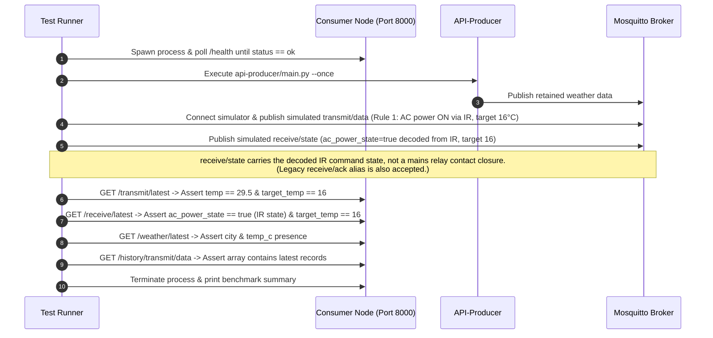

# Peripheral Utilities, CLI Tools & Verification Suites

This document provides complete technical specifications for the auxiliary tools, background daemons, command-line utilities, and automated testing suites in the codebase.

---

## 1. OpenWeatherMap API-Producer Node

Source directory: [utils/api-producer/](file:///home/frdn/Downloads/Kuliah/IoT/Proyek/utils/api-producer/)  
Main script: [main.py](file:///home/frdn/Downloads/Kuliah/IoT/Proyek/utils/api-producer/main.py)

The **API-Producer** is an autonomous Python daemon that fetches real-time external weather metrics and broadcasts them to the MQTT message bus.

```mermaid
flowchart LR
    OWM["OpenWeatherMap API<br/>(api.openweathermap.org)"] -->|HTTPS GET (Units: Metric)| Producer["API-Producer (Python)<br/><code>utils/api-producer/main.py</code>"]
    Fallback["Realistic Fallback<br/>Generator"] -.->|On Network / Auth Failure| Producer
    Producer -->|MQTT PUBLISH api/weather<br/>QoS 1, retain=true| Mosquitto["Mosquitto Broker"]
```

### 1.1 Environment Variables & Configuration
Configured via `.env` in `utils/api-producer/.env` or system environment:

| Variable | Default Value | Description |
| :--- | :--- | :--- |
| `MQTT_HOST` | `127.0.0.1` | Hostname or IP address of the Mosquitto broker. |
| `MQTT_PORT` | `1883` | TCP port of the broker. |
| `MQTT_USER` | `iot_user` | Username for MQTT authentication. |
| `MQTT_PASS` | `iot_password` | Password for MQTT authentication. |
| `OPENWEATHER_API_KEY` | `""` | OpenWeatherMap API key (Free tier compatible). |
| `CITY` | `Jakarta` | Target geographic location. |
| `POLL_SECONDS` | `600` | Polling cadence in seconds (10 minutes). |

### 1.2 Graceful Fallback Mode
If `OPENWEATHER_API_KEY` is not configured, set to a dummy placeholder (`"YOUR_OPENWEATHER_API_KEY"`), or if the host is offline, the daemon falls back to realistic synthetic metrics (`temp_c: 28.5`, `hum: 75`, `desc: "scattered clouds (simulated)"`), ensuring downstream nodes never stall waiting for data.

### 1.3 Command-Line Arguments & Execution
```bash
cd utils/api-producer

# Normal continuous daemon execution:
python main.py

# Single-execution mode (fetches once, publishes, and exits):
python main.py --once
```
*The `--once` flag is designed for automated integration testing and CI environments.*

---

## 2. Infrared Manual Override CLI (`ir_override.py`)

Source script: [ir_override.py](file:///home/frdn/Downloads/Kuliah/IoT/Proyek/utils/tools/ir_override.py)

A standalone command-line tool allowing system administrators and engineers to directly command the climate control system over MQTT without opening a web browser.

### 2.1 Argument Reference

```text
usage: ir_override.py [-h] [--host HOST] [--port PORT] [--username USERNAME]
                      [--password PASSWORD] [--topic TOPIC] [--ack-topic ACK_TOPIC]
                      [--request-id REQUEST_ID] [--timeout TIMEOUT]
                      [--duration DURATION] [--dry-run] [--no-wait]
                      (--release | --raw HEX | [--relay {on,off}] [--temp TEMP] [--fan {off,low,medium,high}])
```

| Argument | Type / Options | Default | Description |
| :--- | :--- | :--- | :--- |
| `--host` | `string` | `localhost` / `MQTT_HOST` | Broker host. |
| `--port` | `integer` | `1883` / `MQTT_PORT` | Broker port. |
| `--username` | `string` | `MQTT_USER` | Broker username. |
| `--password` | `string` | `MQTT_PASS` | Broker password. |
| `--duration` | `integer` (0..86400) | `60` | Duration in seconds (0 = indefinite). |
| `--request-id` | `string` | Auto-generated UUID | Unique correlation token echoed in ACK. |
| `--timeout` | `float` | `5.0` | Seconds to await ACK response before failing. |
| `--dry-run` | Flag | `false` | Prints JSON payload to stdout without connecting. |
| `--no-wait` | Flag | `false` | Dispatches command without blocking for ACK. |

### 2.2 Mutually Exclusive Command Modes
1. **Clear Override (`--release`):**
   Immediately terminates any active manual override on the transmitter, resuming autonomous rules.
   ```bash
   python utils/tools/ir_override.py --release
   ```

2. **Send Raw 32-bit NEC IR Frame (`--raw <HEX>`):**
   Instructs the KY-005 IR LED to emit an explicit raw 32-bit frame. Automatically normalizes hexadecimal input (e.g. `0xA18710EF` or `a18710ef`).
   ```bash
   python utils/tools/ir_override.py --raw 0xA18710EF --duration 120
   ```

3. **Structured Climate Settings (`--relay`, `--temp`, `--fan`):**
   Alters specific control variables. At least one of `--relay`, `--temp`, or `--fan` must be specified.
   ```bash
   # Set target to 22°C with medium fan for 5 minutes (300 seconds):
   python utils/tools/ir_override.py --temp 22 --fan medium --duration 300

   # Force AC off for 30 minutes:
   python utils/tools/ir_override.py --relay off --duration 1800
   ```

---

## 3. End-to-End System Verification Suite (`e2e_integration_test.py`)

Source script: [e2e_integration_test.py](file:///home/frdn/Downloads/Kuliah/IoT/Proyek/scripts/e2e_integration_test.py)

A system verification test that runs an end-to-end integration check across all tiers of the architecture without requiring physical ESP8266 hardware.



### Running the E2E Test Suite
```bash
python3 scripts/e2e_integration_test.py
```

### Verification Assertions
1. **Service Liveness:** Asserts `/health` responds with HTTP 200 within 7.5 seconds.
2. **Weather Ingestion:** Confirms `/weather/latest` returns valid weather metrics populated by the API Producer.
3. **Telemetry Ingestion:** Confirms `/transmit/latest` accurately parses motion state, ambient metrics, and setpoints.
4. **Actuator Feedback Ingestion:** Confirms `/receive/latest` reflects relay state and decoded IR codes.
5. **Sliding Buffer Retention:** Confirms `/history/transmit/data` contains historical telemetry records in arrival order.

---

## 4. Consumer Node Automated Test Suites

The Consumer Node includes extensive unit, integration, and UI testing suites located in [visualization/consumer/server/test/](file:///home/frdn/Downloads/Kuliah/IoT/Proyek/visualization/consumer/server/test/) and [visualization/consumer/tests/](file:///home/frdn/Downloads/Kuliah/IoT/Proyek/visualization/consumer/tests/).

### 4.1 Native Node.js Unit & Integration Tests
Uses Node's built-in test runner (`node --test`). No external test frameworks (e.g. Jest or Mocha) are required.

```bash
cd visualization/consumer
npm test
```

#### Test Suite Catalog
| Test File | Focus Area | Key Scenarios Tested |
| :--- | :--- | :--- |
| **`server/test/api.test.js`** | REST API Endpoints | Dual `/api` route mounting, 404 handling, JSON formatting, `/dashboard` snapshot generation, topic alias resolution, and error response formatting. |
| **`server/test/commands.test.js`** | Zod Command Validation | Schema validation for `override`, `release`, `raw` actions; boundary checks on temperature (16..30°C); fan speed whitelist; UUID fallback on HTTP LAN. |
| **`server/test/mqtt-service.test.js`** | MQTT Logic & Resilience | Subscription handling, connection recovery, pending command promise tracking, publish timeout triggers, and ACK timeout triggers. |
| **`server/test/mqtt-wire.test.js`** | Wire-Level Protocol | Ingestion of malformed JSON strings, schema mismatch isolation, retain flag filtering, and LWT packet processing. |

---

### 4.2 Playwright End-to-End Browser UI Tests
Source: [tests/dashboard.spec.js](file:///home/frdn/Downloads/Kuliah/IoT/Proyek/visualization/consumer/tests/dashboard.spec.js)

Runs headless browser tests using [Playwright](https://playwright.dev/) against the compiled React dashboard:

```bash
cd visualization/consumer
npm run test:ui
```

#### Scenarios Verified
- **DOM Rendering & Themes:** Validates that dashboard renders without JavaScript errors, displays correct Indonesian typography, and switches light/dark themes cleanly.
- **Sensor Alert Banners:** Simulates sensor warmup (`warmup: true`) and stale telemetry, asserting that warning alert banners appear.
- **Manual Control Flow:** Interacts with the temperature stepper and fan selector, verifies optimistic draft locking, and tests command submission.

---

### 4.3 Docker Smoke Test Suite
Source: [tests/docker-smoke.js](file:///home/frdn/Downloads/Kuliah/IoT/Proyek/visualization/consumer/tests/docker-smoke.js)

Verifies production container properties:
- Confirms the container runs under unprivileged UID `1000` (`node`).
- Validates that the root filesystem is read-only.
- Verifies that `/tmp` is mounted as a `tmpfs`.
- Validates graceful shutdown under `SIGTERM` within the 15-second grace period.
